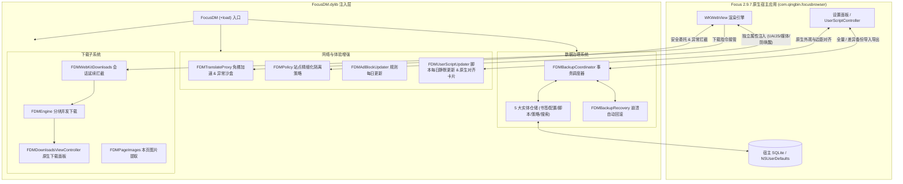

# FocusDM v20 — iOS Focus 2.9.7 原生注入增强补丁

[](https://github.com/IamNewHands/FocusDownloads/actions/workflows/build.yml)
[](https://github.com/IamNewHands/FocusDownloads/releases/tag/nightly)
[](https://apple.com/ios)
[](https://developer.apple.com)

`FocusDM` 是专为 iOS 平台 Focus 浏览器（版本 2.9.7，Bundle ID: `com.qingbin.focusbrowser`）打造的纯 Objective-C 注入增强动态库（`FocusDM.dylib`）。本补丁在不破坏原有宿主架构的前提下，通过运行时方法置换（Method Swizzling）与原生视图合成，为 Focus 补充了强大的**全场景下载管理**、**全站与单站隔离策略**、**本地安全数据备份**、**免翻墙高速网页翻译与防崩溃保护**、以及**广告规则与用户脚本每日自动更新**等核心高级功能。

---

## 目录

- [核心功能特性](#核心功能特性)
  - [1. 高级下载管理引擎](#1-高级下载管理引擎)
  - [2. 免代理高速翻译与崩溃隔离](#2-免代理高速翻译与崩溃隔离)
  - [3. 用户脚本与广告规则自动更新](#3-用户脚本与广告规则自动更新)
  - [4. 精细化全站 / 单站策略系统](#4-精细化全站--单站策略系统)
  - [5. 本地无损数据备份与还原](#5-本地无损数据备份与还原)
  - [6. 原生交互与视觉体验打磨](#6-原生交互与视觉体验打磨)
- [仓库文件结构](#仓库文件结构)
- [核心源码与模块说明](#核心源码与模块说明)
  - [注入源码 (`src/`)](#注入源码-src)
  - [打包与补丁工具 (`tools/`)](#打包与补丁工具-tools)
  - [测试套件 (`tests/`)](#测试套件-tests)
- [工作原理与关键技术实现](#工作原理与关键技术实现)
- [本地构建与 IPA 打包](#本地构建与-ipa-打包)
- [安装与重签名说明](#安装与重签名说明)

---

## 核心功能特性

### 1. 高级下载管理引擎
- **全场景下载接管**：无缝拦截 WebKit 的 `WKNavigationResponsePolicyDownload`、原生附件下载、手动添加的直链队列及本页图片下载，统一交由 `FocusDM` 调度管理。
- **上下文延续与会话保持**：原网页下载自动继承当前 WebView 的请求头、Cookie 与上下文凭据，避免因二次请求导致鉴权失效或防盗链拦截。
- **本页图片提取**：在网页工具菜单中提供「下载本页图片」入口，以网格视图即时展示页面内所有图片资源，支持多选、反选、全选与批量异步并发入库下载。
- **强大的队列与续传控制**：支持分块断点续传（Range 请求）、多任务并发调度（默认 3 并发，可控 1~6）、自动重试、实时测速、任务暂停/恢复。
- **原生管理面板**：内嵌于设置页及原下载菜单入口，提供「全部 / 下载中 / 已完成」分段筛选、全文关键词搜索、QuickLook 快捷预览、滑动删除与成品保留策略。

### 2. 免代理高速翻译与崩溃隔离
- **免翻墙高可用翻译代理**：针对国内网络环境下谷歌/必应等翻译 API 超时不可用的痛点，内置高速直连翻译通道，实现无需代理工具下的秒级极速整页与划词翻译。
- **选词翻译 100% 防崩溃拦截**：彻底修复 iOS WebKit 私有视图 `WKContentView` 缺少公共 `translate:` 选择器（实际底层为私有 `translateForWebView:`）导致的长按选词点击翻译必现应用闪退缺陷，全链路增加 `@try / @catch` 异常沙盒隔离与回退处理。
- **系统离线能力适配**：无缝打通 iOS 15+ 现代系统自带离线翻译包，在无网或弱网环境下仍可稳定完成取词翻译。

### 3. 用户脚本与广告规则自动更新
- **全自动每日静默更新**：每日冷启动进入应用后自动触发一次后台静默更新检查，自动拉取并刷新已安装的 GreasyFork / 自建用户脚本及 AdBlock 规则，无需手动逐个点击。
- **原生卡片式界面集成**：在「脚本管理」顶部无缝注入原生风格的「脚本每日自动更新」控制卡片，完美支持浅色与深色模式自适应。
- **像素级绝对对齐排版**：基于对宿主 `UserScriptDetailCell` 布局引擎的逆向解析，提取原生左右边距（15pt/10pt）与动态坐标系换算，使更新开关与下方的所有脚本开关保持水平绝对对齐，彻底杜绝文本与开关悬浮重叠。

### 4. 精细化全站 / 单站策略系统
- **域名颗粒度隔离**：以精确的 `scheme://host:effectivePort` 为键值管理独立站点规则，支持针对特定网站进行定制化行为控制。
- **多维度规则配置**：
  - 桌面版 / 移动版 User-Agent 自由切换
  - 页面独立缩放比例定制
  - 阅读模式（Reader）强制启用 / 禁用
  - 页面 JavaScript 执行开关
  - 内容拦截器（Content Blocking）独立开关
  - 用户脚本（Tampermonkey / Userscript）注入独立控制
  - 摄像头 / 麦克风多媒体硬件权限独立管理
  - 拦截唤起外部第三方 App（防唤醒流氓行为）
- **当前标签临时穿透**：网页菜单提供快捷入口，可临时放行或关闭当前域名的增强策略。

### 5. 本地无损数据备份与还原
- **分项全量导出**：支持导出包含书签收藏、首页快捷方式、搜索引擎配置、全站/单站安全策略、白名单偏好及已安装用户脚本的 `.browserbackup` 备份文件。
- **导入差异预览**：导入时先行解析文件完整性，清晰列出「新增 / 相同 / 冲突 / 权限降级 / 脚本禁用」具体项数。
- **冲突合并与替换策略**：默认合并策略保留本地同 ID 冲突项，同时支持所选类别替换，全过程执行本地事务快照与失败自动回滚机制。
- **安全沙盒限额**：单文件最大支持 32 MiB 解码、书签支持达 10,000 条，导入脚本强制校验原文与元数据哈希，摄像头/麦克风权限自动安全降级为“询问”。

### 6. 原生交互与视觉体验打磨
- **原生转场与层级规范**：重构设置页二级菜单推入/弹出逻辑，遵循宿主原生右向左推入动效与原生返回键（避免突兀的关闭按钮）。
- **界面瑕疵根除**：彻底解决进入子设置页面、下载管理页与网站规则页顶部出现的灰带、白色接缝及侧滑返回残影等界面视觉缺陷。

---

## 仓库文件结构

```text
FocusDownloads/
├── .github/
│   └── workflows/
│       └── build.yml               # GitHub Actions 自动化编译流水线与测试门禁
├── docs/                           # 架构决策记录 (ADR)、基线治理与真机记录
│   ├── aegis/                      # 架构规范与执行基线
│   └── focus-v20-device-regressions-2026-11-10.md
├── src/                            # 动态库核心 Objective-C 注入源码
│   ├── FocusDM.m                   # 动态库入口，统筹初始化所有子系统
│   ├── FDMCommon.[h|m]             # 基础工具宏、日志输出与安全类型转换
│   ├── FDMJSON.[h|m]               # 跨版本 JSON 编解码与数据安全提取
│   ├── FDMStore.[h|m]              # SQLite 核心数据库引擎与连接池管理
│   ├── FDMVault.[h|m]              # 敏感配置及 Keychain 安全数据存取
│   ├── FDMIntent.[h|m]             # 意图路由与跨模块调用安全分发
│   ├── FDMEngine.[h|m]             # 多线程分块下载引擎、断点续传核心调度
│   ├── FDMHostDownloads.[h|m]      # 宿主下载菜单与交互行为钩子
│   ├── FDMWebKitDownloads.[h|m]    # WebKit 原生下载请求与上下文代理
│   ├── FDMDownloadsViewController.[h|m] # 下载管理器完整 UI 界面实现
│   ├── FDMPageImages.[h|m]         # 「下载本页图片」网格提取器与交互视图
│   ├── FDMPolicy.[h|m]             # 站点独立策略核心状态与存储管理
│   ├── FDMNavigation.[h|m]         # 原生导航栈控制与视图控制器推入修复
│   ├── FDMPageNavigation.[h|m]     # 网页页面跳转与转场白屏/灰带修复
│   ├── FDMNativePages.[h|m]        # 原生偏好面板与二级设置页面渲染支持
│   ├── FDMIcons.[h|m]              # 高清矢量图标与工具栏渲染
│   ├── FDMIconDiagnostics.m        # 图标渲染诊断工具
│   ├── FDMTranslateProxy.[h|m]     # 免代理高速翻译转发与 WebKit 翻译防闪退保护
│   ├── FDMUserScriptUpdater.[h|m]  # 用户脚本每日自动更新与脚本管理页原生卡片
│   ├── FDMAdBlockUpdater.[h|m]     # 广告拦截规则每日自动更新调度器
│   ├── FDMBackup.[h|m]             # 备份与还原数据总控入口
│   ├── FDMBackupCoordinator.m      # 导入/导出事务协调与进度控制
│   ├── FDMBackupReadBarrier.[h|m]  # 备份数据读取内存屏障与并发保护
│   ├── FDMBackupRecovery.[h|m]     # 备份中断回滚与启动时一致性恢复
│   ├── FDMBackupSQL.[h|m]          # 备份数据 SQLite 底层直读与写入包装
│   ├── FDMBackupRepository.h       # 备份仓储通用协议
│   ├── FDMBackupRepositoryImpl.h   # 备份仓储基类与通用工具
│   ├── FDMBackupRepositoryBookmarks.m    # 书签与主页快捷项备份仓储
│   ├── FDMBackupRepositoryPolicy.m       # 站点策略配置备份仓储
│   ├── FDMBackupRepositoryPreferences.m  # 应用偏好与搜索引擎配置仓储
│   ├── FDMBackupRepositoryScripts.m      # 用户脚本源码与元数据仓储
│   └── FDMBackupRepositorySearch.m       # 搜索引擎自定义配置仓储
├── tests/                          # 完整测试套件（原生编译测试 + Python 验证）
│   ├── test_v20_contracts.py       # 核心架构契约与接口覆盖测试
│   ├── test_translate_proxy_contracts.py  # 翻译代理通道与 WebKit 异常保护契约
│   ├── test_userscript_autoupdate_contracts.py # 脚本自动更新与 UI 对齐契约
│   ├── test_adblock_autoupdate_contracts.py    # 广告规则自动更新契约
│   ├── test_backup_export_contracts.py    # 数据备份与导出还原完整契约
│   ├── test_page_navigation_contracts.py  # 页面转场与导航契约
│   ├── test_settings_ui_contracts.py      # 设置界面一致性测试
│   ├── test_packaging.py           # IPA 打包与 Mach-O 结构完整性校验
│   ├── backup_regression.m         # 备份 SQLite 事务与一致性原生回归测试
│   ├── engine_regression.m         # 下载引擎断点续传与并发原生回归测试
│   ├── host_regression.m           # 宿主方法置换与环境钩子回归测试
│   ├── icons_regression.m          # 图标渲染与像素级边界回归测试
│   └── navigation_regression.m     # 导航栏生命周期与转场动效回归测试
└── tools/                          # 打包构建与 Mach-O 注入工具
    ├── build_focus.py              # 未签名 IPA 组装、Mach-O 注入与产物校验脚本
    ├── safe_macho.py               # 纯 Python 实现的安全 Mach-O 解析与 LC_LOAD_DYLIB 注入
    ├── provenance.py               # 源码凭据、Git Commit SHA 校验与签名追溯
    ├── focus_patches.py            # 宿主二进制补丁辅助解析工具
    └── focus_2_9_7_patches.json    # Focus 2.9.7 既有二进制补丁清单（VIP/CloudKit/去广告等）
```

---

## 核心源码与模块说明

### 注入源码 (`src/`)

| 源码文件 | 核心职责 |
|---|---|
| `FocusDM.m` | **动态库总入口**。在应用加载（`+load`）时自动执行，初始化下载引擎、安装各模块方法置换（Swizzling）、挂载通知监听并触发启动时校验。 |
| `FDMDownloadsViewController` | **下载管理 UI**。基于 `UITableView` 与原生样式打造，承载所有下载任务的展示、实时速率刷新、搜索、分类与操作。 |
| `FDMEngine` | **下载引擎核心**。基于 `NSURLSession` 自定义并发队列，实现 Range 请求拆分分块、临时文件原子合并、速度滑动窗口采样及状态机维护。 |
| `FDMWebKitDownloads` | **WebKit 下载拦截**。置换 `WKWebView` 内部代理方法，捕获文件流式下载、Blob 链接及直接跳转下载。 |
| `FDMPageImages` | **本页图片嗅探**。通过向当前页面注入轻量提取脚本，收集图片元素与 CSS 背景图片，在原生全屏弹窗中支持网格多选并发下载。 |
| `FDMPolicy` | **站点策略引擎**。维护每个站点的 UA、缩放、JS、脚本、媒体权限与外部 App 唤醒限制，精准作用于单个浏览标签。 |
| `FDMTranslateProxy` | **翻译加速与防崩溃**。将翻译流量路由至高速免梯通道；同时安全 Hook 页面划词翻译链路，拦截 WebKit 内部 `unrecognized selector` 崩溃。 |
| `FDMUserScriptUpdater` | **脚本每日更新**。通过定时检查与启动时间戳比对，静默驱动 `UserScriptUpdateManager`，并在脚本管理页构建完美像素对齐的卡片与开关。 |
| `FDMAdBlockUpdater` | **规则每日更新**。周期性自动更新去广告拦截规则，保持规则库最新。 |
| `FDMBackup*` 系列 | **完整数据备份生态**。包含协调器、读取屏障、事务恢复机制与 5 大实体仓储（书签、策略、偏好、脚本、搜索），确保备份与还原 100% 可靠。 |
| `FDMNavigation` / `FDMNativePages` | **导航与视图打磨**。修正 Focus 原生导航栈在呈现自建页面时的视觉瑕疵，确保转场动画、标题栏与返回手势与原生完全一致。 |

### 打包与补丁工具 (`tools/`)

| 工具文件 | 核心职责 |
|---|---|
| `build_focus.py` | **自动化打包主入口**。接收原始 Focus 2.9.7 IPA、编译好的 `FocusDM.dylib` 与构建清单，在内存中完成合法性校验并输出新 IPA。 |
| `safe_macho.py` | **零依赖 Mach-O 修改器**。纯 Python 解析 64-bit Mach-O 二进制文件头与 Load Commands，精准注入 `@executable_path/FocusDM.dylib`，不破坏代码签名偏移。 |
| `provenance.py` | **构建溯源校验器**。在打包前校验 Git 提交散列值、源文件 MD5/SHA-256、编译器参数与 dylib 内部编译标记的一致性，防止脏包发布。 |
| `focus_2_9_7_patches.json` | **宿主二进制修正清单**。记录 Focus 2.9.7 自身所需的基础补丁规则（如 VIP 权益解锁、去除崩溃统计、放宽内购限制等）。 |

### 测试套件 (`tests/`)

- **Python 契约测试 (`test_*.py`)**：快速在本地验证源码中所有对外常量、选择器动态解析、无硬编码符号依赖、UI 控件布局约束及打包管道逻辑（共 100+ 项测试用例，本地运行秒级完成）。
- **Objective-C 原生回归测试 (`*_regression.m`)**：在 macOS / iOS 模拟器环境中直接编译运行，针对 SQLite 数据事务、并发下载多断点恢复、WebKit 导航请求重定向以及 Retina 图标抗锯齿渲染等核心逻辑进行严格的功能回溯。

---

## 工作原理与关键技术实现



1. **动态解耦设计**：
   所有对 Focus 原生私有类的引用（如 `UserScriptController`、`UserScriptUpdateManager`、`RuleManager` 等）全部使用 `NSClassFromString()` 与 `NSSelectorFromString()` 运行时动态解析，不包含任何外部硬编码符号，确保编译产物具备极强的宿主版本兼容性与安全性。
2. **WebKit 异常物理隔离**：
   针对 `WKContentView` 缺少 `translate:` 导致的崩溃，采用多层防护：优先使用 `[super translate:]` 进行安全分派；若宿主实现不同，则回退调用 `translateForWebView:`，所有消息调用严格包覆在 `@try ... @catch (NSException *e)` 中，确保应用永远不会因为翻译异常而闪退。
3. **像素级卡片对齐算法**：
   在 `UserScriptController` 注入 Header 时，重写 `layoutSubviews`。不仅提供精确的原生边距 fallback（iPhone: 15pt 侧边距 / 10pt 开关偏移；iPad: 20pt 侧边距 / 20pt 开关偏移），更在视图树渲染时动态探测当前可见 `UserScriptDetailCell` 的 `backView` 与 `switchView` 屏幕绝对位置并做坐标转换，实现真正的亚像素级对齐。

---

## 本地构建与 IPA 打包

### 1. 运行本地自动化测试

在提交代码或打包前，可在本地运行全量回归测试：

```bash
# 运行全部 Python 契约与接口覆盖测试
python -m unittest discover -s tests -p "test_*.py"
```

### 2. 通过 GitHub Actions 自动化构建

仓库已配置完善的 CI 流水线（`.github/workflows/build.yml`）：
- 每次向 `main` 分支推送代码，GitHub Actions 会在 `macos-15` 环境下拉取最新的 iOS SDK 编译出经过严格测试校验的 arm64 架构动态库 `FocusDM.dylib` 与 `FocusDM.provenance.json`。
- CI 构建成功后，会自动触发 Nightly 单一滚动发布并更新下载资产。

### 3. 本地打包最终 IPA

当获取到 CI 构建生成的 `FocusDM.dylib` 与 `FocusDM.provenance.json` 后，使用项目内置的打包工具合成最终未签名安装包：

```powershell
python tools/build_focus.py `
  --ipa "Focus_2.9.7.ipa" `
  --dylib "_ci_dl/FocusDM.dylib" `
  --provenance "_ci_dl/FocusDM.provenance.json" `
  --source-root "D:\GitHub_Clone\FocusDownloads" `
  --out "Focus_2.9.7_patched_v20_final.ipa"
```

> [!NOTE]
> `build_focus.py` 执行时会对原版 IPA 进行哈希校验，并对新生成的 IPA 执行严格的 ZIP 完整性及二进制加载命令检验，确保生成产物 100% 结构合法。

---

## 安装与重签名说明

构建产出的 IPA 文件为**未签名版本**，无法直接安装到未越狱设备上。安装前请遵循以下步骤：

1. **选择签名工具**：
   - **TrollStore（巨魔商店）**：直接分享至 TrollStore 安装，无需个人签名，永久有效，推荐首选。
   - **LCSign / 轻松签 / 牛怪**：导入未签名 IPA，搭配个人免费证书或企业证书完成重签名并覆盖安装。
   - **AltStore / Sideloadly**：连接电脑使用 Apple ID 签名安装。
2. **覆盖安装注意事项**：
   - 保持签名所用的 Bundle ID 与设备上已安装的 Focus 一致即可实现**保留所有历史网页、书签与脚本无损覆盖升级**。
   - **严禁**先卸载原应用再安装，否则原有应用沙盒数据将被 iOS 系统彻底清除。在执行大版本跨越升级前，建议先在设置中使用「数据备份」导出全量备份备用。

---

## 免责声明

- 本项目仅供 iOS 逆向工程、Objective-C 运行时机制及浏览器架构的技术学习与研究交流。
- 本仓库不分发任何商业闭源应用的原版安装包或涉及侵权的资源文件。
- 用户需自行对侧载应用及其产生的数据负责，作者不承担因使用不当产生的任何数据丢失责任。
